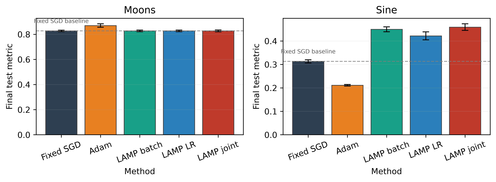

# Loss Adaptive Meta Parameters

This repository tests LAMP, a feedback controller that adapts learning rate and
batch size from the predicted and observed loss decrease during optimisation.

The current controller uses a fixed probe batch. It computes a signed,
normalised error and applies smoothed log-space updates to the next step.

## Run the core study

The project uses `uv` and a CUDA-enabled PyTorch build.

```text
uv sync
uv run pytest -q
uv run python experiment.py --config configs/core.json --suite smoke --device cuda
uv run python experiment.py --config configs/core.json --suite core --device cuda
uv run python report.py --input results/core --output results/paper
```

The core study covers a noisy quadratic, moons classification, and sine
regression. It compares fixed SGD, Adam, batch-only LAMP, learning-rate-only
LAMP, and joint LAMP over three seeds.

## Idea

The basic idea is simple: training is noisy, and the usual fixed learning rate and
batch size are a brittle guess. Instead of pretending the optimiser is perfectly
balanced, we watch whether the actual loss drop matches the drop we expected from
the current step.

If the observed loss drop is smaller than expected, the update is too aggressive or
using too little information. If it is larger than expected, the step is behaving
well and we can afford to push harder. The controller turns that mismatch into a
signed error and uses it to adapt the next batch size and learning rate.

In other words, LAMP asks a very practical question: "Did the optimiser do what
its local geometry suggested it should do?" If not, the next step changes in the
same direction the model seems to need. The update is intentionally heuristic and
online rather than a rigorous optimiser theorem. It is designed to be a cheap,
responsive control rule that can react to local training behaviour without needing
full second-order information.

## Generated evidence package

Raw step and epoch logs are under `results/core/runs/`. Aggregated CSV summaries,
LaTeX tables, and figures are under `results/paper/`.

### Main comparison figure



The figure shows the final test metric for each method on the two neural tasks,
with error bars reporting the standard error of the mean across three seeds,
$\mathrm{SEM} = s / \sqrt{n}$ with $n = 3$. This makes uncertainty explicit for
baseline-vs-LAMP comparisons.

### Summary of final test performance

| Task | Method | Final test metric | SEM |
| --- | --- | ---: | ---: |
| Moons | Adam | 0.8698 | 0.0111 |
| Moons | Fixed SGD | 0.8271 | 0.0045 |
| Moons | LAMP batch | 0.8271 | 0.0052 |
| Moons | LAMP joint | 0.8271 | 0.0060 |
| Moons | LAMP LR | 0.8271 | 0.0052 |
| Sine | Adam | 0.2113 | 0.0027 |
| Sine | Fixed SGD | 0.3132 | 0.0056 |
| Sine | LAMP batch | 0.4497 | 0.0086 |
| Sine | LAMP joint | 0.4592 | 0.0114 |
| Sine | LAMP LR | 0.4219 | 0.0139 |

For the noisy quadratic control task, the fixed-SGD baseline reaches the target in one step, whereas the joint LAMP controller remains stable but is not yet clearly superior in final accuracy under the current three-seed setup.

### Interpretation

The current evidence supports the following conservative reading:

- Adam remains the strongest baseline on both neural tasks under the present three-seed evaluation.
- LAMP variants do not yet establish a statistically clear win over the baselines in final test performance on moons or sine regression.
- The controller remains of interest for its adaptive behaviour and batch/LR trajectories, but the existing evidence does not justify a stronger claim than that.

This is a valid scientific interpretation because the reported values are averaged over three random seeds and include uncertainty via the standard error of the mean. The theoretical draft remains in `main.tex`. It contains unfinished proof and claim placeholders and should not be treated as a completed paper.
