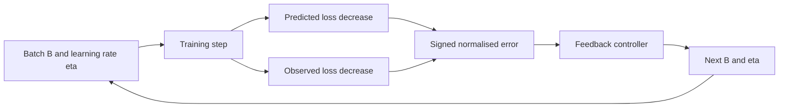

# Loss Adaptive Meta Parameters
Also named LOCCO, sorry.
## AI Statement:
I had an idea, and asked AI to implement it. 
Theory in `main.tex` and code in the repo. 
I reviewed most of it, enjoy.
Similar idea to:

# Research idea

This project tests whether training can adapt its batch size $B_t$, and optionally its learning rate $\eta_t$, from the loss signal observed during optimisation. The motivation is practical. A fixed learning rate and batch size can work well for one task and fail for another, while manual tuning is costly.

LOCCO compares the loss decrease predicted from the current gradient with the loss decrease observed after an update:

$$
\Delta L_{\mathrm{det},t}
\approx
\eta_t\lVert\widehat{g}_t\rVert^2
-
\frac{\eta_t^2}{2}q_t
$$

$$
e_t =
\frac{\Delta L_{\mathrm{det},t}-\Delta L_{\mathrm{obs},t}}
{\eta_t\lVert\widehat{g}_t\rVert^2+\varepsilon}
-\widetilde{\gamma}
$$

Here, $\widehat{g}_t$ is the current gradient estimate, $q_t$ is a curvature term or curvature proxy, $\Delta L_{\mathrm{obs},t}$ is the measured loss decrease, and $\widetilde{\gamma}$ is the target stochastic-loss fraction. The signed error $e_t$ gives the controller a direction. It can increase or decrease the next batch size rather than only increasing it.

The equations describe the intended LOCCO design. The current prototype in [`draft.py`](draft.py) implements only part of that design.

# Experimental/WiP state

## What has been done

The repository contains one end-to-end PyTorch prototype covering synthetic moons, blobs, sine-regression, and linear-regression tasks. It compares linear models and MLPs with SGD, cosine-SGD, Adam, and the current LOCCO controller. The saved suite contains 19 runs: 6 POC runs, 6 benchmark runs, 3 ablations, and 4 extreme-setting runs. Each run has a CSV log and PNG plot, with an aggregate table in [`results/SUMMARY.csv`](results/SUMMARY.csv) and all outputs in [`results/`](results/). The saved experiments use seed `1337`.

## What was found

| Evidence | Saved result |
| --- | --- |
| POC moons | LOCCO finishes at 0.6938 test accuracy, compared with 0.8719 for MLP Adam |
| POC sine | LOCCO finishes at 0.5084 test RMSE, compared with 0.2066 for MLP Adam |
| Batch trajectory | LOCCO commonly finishes at its configured upper batch bound |

The saved runs do not show a benefit from LOCCO on the current tasks. They use one seed and omit efficiency measures, so they cannot establish a general performance conclusion.

## What is missing

- A faithful implementation of the specified controller, including signed log-space control, target error, deadband, hysteresis, probe loss, and controller diagnostics.
- Evidence needed to test the claim, including multiple seeds, time-to-target, examples-to-target, AULC, controller trajectories, the specified ablations, and baseline comparisons for extreme settings.
- Focused controller tests and a reproducible command-line entry point.

Current status: runnable exploratory prototype, with the research claim still unverified.